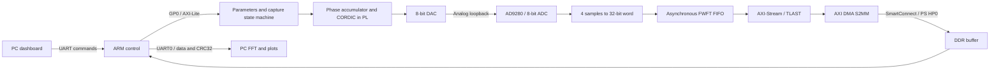
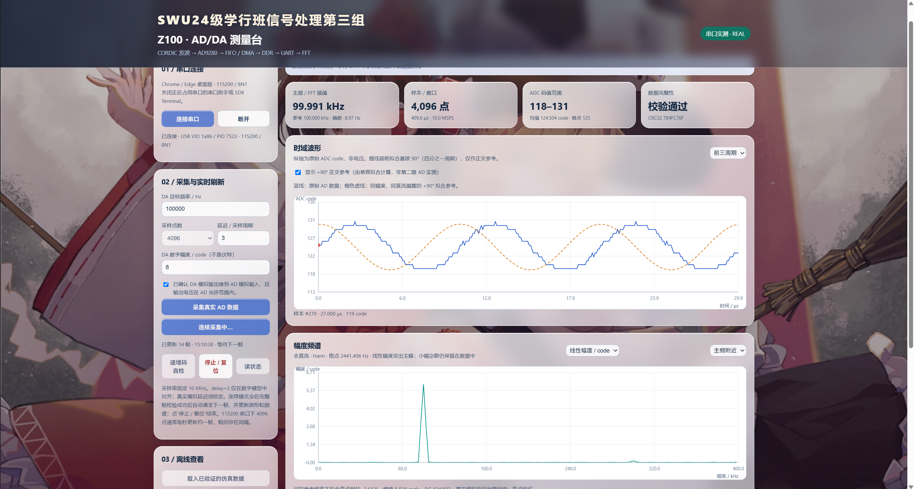

# Z100 FPGA Acquisition, DDR Storage & FFT Testbed

[](https://github.com/WuWingKit/z100-ad9280-capture/releases/tag/v0.3.0-20261029)
[](https://github.com/WuWingKit/z100-ad9280-capture/actions/workflows/source-checks.yml)


[English](README.md) | [简体中文](README.zh-CN.md) | [日本語](README.ja.md) | [한국어](README.ko.md) | [Русский](README.ru.md) | [Português](README.pt.md) | [Español](README.es.md) | [Français](README.fr.md)

An educational acquisition and storage testbed for **SWU Class of 2024, Xuexing Class, Signal Processing Group 3 — Part 3**. It prepares an FPGA data path for future phased-array radar work using a known DAC-to-ADC loopback signal before radar data is available.

**Current release: [v0.3.0-20261029](https://github.com/WuWingKit/z100-ad9280-capture/releases/tag/v0.3.0-20261029).** The default branch is `main`. This is a preliminary data-path validation project, not a complete radar implementation.

## What is implemented



- PL: CORDIC sine generation, deterministic acquisition timing, four-byte packing, FIFO buffering and AXI-Stream transfer.
- PS: register configuration, DMA submission/completion, cache maintenance, checks and UART output.
- PC: frame parsing/CRC validation, DC removal, Hann window, FFT, frequency interpolation and plotting.
- Dashboard: single-frame or user-started repeated captures; linear/dB spectra; a fitted **+90° reference**, not a second measured ADC channel; CSV/JSON/PNG/raw-log export.

Radar inputs, beamforming, target separation, range/angle estimation, ping-pong buffering and PL FFT are **not implemented in this release**. Repeated captures contain gaps; they are not a continuous 10 MSPS UART stream.

## Requirements and tested versions

Choose dependencies for the workflow you actually use. The dashboard does not require Node.js, NumPy or an npm install.

| Workflow | Requirement | Version / status |
|---|---|---|
| Hardware | ALIENTEK Z100, XC7Z035FFG900-2; matching J37 AD/DA module with AD9280 and 8-bit DAC | Pinout follows the supplied board example; see `constraints/z100_adc.xdc` |
| FPGA build/simulation | Xilinx Vivado and required Zynq-7000 device/IP support | **2018.3**, used for the existing bitstream and simulations |
| PS build/debug | Xilinx SDK, bundled ARM toolchain, BSP and XSCT | **2018.3**; use SDK, not a Vitis-only workflow |
| Local dashboard server | Python standard library | **3.12.14 tested**; other Python versions are not qualified here |
| Live serial dashboard | Desktop Chrome or Edge with `navigator.serial`, localhost HTTP, board USB-UART driver | No exact browser version is pinned; Web Serial availability is checked on the page |
| Debug connection | Compatible JTAG driver/cable and PS USB-UART driver | Board/vendor drivers; OS-specific |
| Optional Python acquisition/plots | NumPy, Matplotlib, pyserial | Requirements: `numpy>=1.26`, `matplotlib>=3.8`, `pyserial>=3.5` |
| Local optional Python environment | Same packages | Installed versions used in this project: **NumPy 2.5.4**, **Matplotlib 3.11.2**, **pyserial 3.5**; unpinned requirements are not a lockfile |
| JavaScript developer tests only | Node.js | **22.19.0 tested**; no npm dependencies |
| CI RTL smoke test only | Icarus Verilog on GitHub-hosted Ubuntu | Installed by CI; no fixed Icarus version is claimed |

The prepared workflow targets Windows and Vivado/SDK 2018.3. Portable source checks on Linux do not qualify another OS or tool release for board deployment. No external JavaScript/CDN runtime dependencies are used by the dashboard; README badges themselves are remote GitHub/Shields images.

## Quick start: dashboard without hardware

1. Download the full project or dashboard ZIP from the [release page](https://github.com/WuWingKit/z100-ad9280-capture/releases/tag/v0.3.0-20261029).
2. Run `web/start_dashboard.cmd` in the project package, or `start_dashboard.cmd` in the standalone dashboard package.
3. Alternatively, from the repository root:

   ```powershell
   python web/serve.py --open
   ```

4. Open `http://127.0.0.1:8765/` in desktop Chrome/Edge. Click **载入已验证的仿真数据** to load the digital simulation demo. The dashboard controls currently remain in Chinese.

The demo does not open a serial port or operate the board. Its 4096-point result is approximately **99.992 kHz**, and it is explicitly marked as simulated. The server binds only to localhost. Do not open `index.html` directly via `file://`.



*Physical-board screenshot supplied by the group. The orange curve is a fitted reference; see the evidence boundaries below.*

## Download the right artifacts

| Release asset | Contents |
|---|---|
| `z100_complete_project_20261029.zip` | Complete Vivado project, generated IP products, SDK projects, sources, web app and evidence; recommended starting point |
| `z100_dashboard_20261029.zip` | Standalone dashboard including local wallpaper assets; no firmware |
| `weekly_report_with_images_20261029.zip` | Offline illustrated weekly report; open `report.html` after extraction |
| `z100_cordic.bit` / `adc_uart.elf` | Matching FPGA configuration and ARM program |
| `z100_cordic.hdf` | Hardware description for SDK |
| `BOARD_TEST.md` | Board test instructions |
| `SHA256SUMS.txt` | SHA-256 checksums for the release assets |

GitHub's automatically generated source ZIP is **not** the complete prebuilt project package. Download the named release asset if you need generated IP products and the SDK workspace. Older releases remain available for traceability; do not mix old 100-sample firmware with this version.

## Board test through SDK Debug

1. Check J37 orientation, IO-bank voltage and the analog connection. Connect DAC analog output to ADC analog input with a common ground; confirm the actual voltage is inside the ADC module's allowed range.
2. Connect JTAG and the **PS USB-UART**, then power the board according to its documentation.
3. Start **Xilinx SDK 2018.3 independently**, selecting the extracted `sdk_workspace`. If projects are missing, import `z100_hw`, `adc_bsp` and `adc_uart` with **File → Import → General → Existing Projects into Workspace**.
4. In **Program FPGA**, browse to `hardware/z100_cordic.bit`. Leave Partial Bitstream unchecked and BMM/MMI empty.
5. Debug `adc_uart` using **Launch on Hardware (System Debugger)** and the matching ELF. If stopped at `main`, click **Resume**.
6. Close SDK Terminal/other serial applications. Connect the browser to the PS USB-UART at **115200, 8N1**, with no flow control.
7. Run **递增码自检** first. Expect `SELFTEST PASS`. Then confirm the analog connection in the page and run **采集真实 AD 数据**.
8. After a successful frame, **开始连续采集** requests another frame only after the previous frame has been fully validated. **停止 / 复位** cancels further requests and sends `q`.
9. Stop and finish the current response before saving/exporting or refreshing the page. The in-page raw log retains only the latest approximately 2 MB.

This workflow uses volatile JTAG loading and does not program Flash. A bitstream alone does not execute the ARM application. One serial port cannot be shared by the browser, SDK Terminal and Python simultaneously. If Vivado's Launch SDK cannot locate an exported system file, use the independent SDK workspace route above.

See [detailed board instructions](docs/BOARD_TEST.md). ELF debug source lookup may need to point to your extracted `sdk_workspace/adc_uart/src`, or you can rebuild the imported SDK projects.

## Parameters and UART commands

| Parameter | Value / range |
|---|---|
| ADC sampling / DAC updates | Fixed **10 MHz** |
| AXI clock | **100 MHz** |
| DAC frequency | 1 kHz–1 MHz; default 100 kHz |
| Frame length `N` | 256 / 512 / 1024 / 2048 / 4096 **8-bit samples (bytes)** |
| FIFO | Asynchronous FWFT, **1024 × 32 bits**, 32-bit write/read |
| Delay | 0–255 sample periods; default 3; 100 ns per period |
| Amplitude | 0–96 digital codes, not volts; dashboard default 8, argument-free firmware default 24 |

```text
t 100000 4096 3 8
m 100000 4096 3 8
s
q
r
h
```

`t`: internal RAMP self-test; `m`: real ADC capture with DAC sine output (`c` is an alias); `s`: status; `q`: stop/reset; `r`: full-path reset; `h`: help. Commands end with a newline. During UART printing, a stop request is handled after printing finishes. After a failed acquisition, reset before retrying.

The samples are packed as `{s3,s2,s1,s0}`; the earliest sample occupies the low byte. `stream_done` means the final AXIS word was accepted, whereas DDR completion requires DMA IOC/not-busy checks. PS cache flush/invalidate is part of the protocol.

## Results and interpretation

Group members supplied physical-board screenshots on **2026-10-29**:

| Requested frequency | Displayed FFT estimate | Displayed deviation | ADC range |
|---|---|---|---|
| 10 kHz | 10.019 kHz | +19.48 Hz | 118–131 |
| 100 kHz | 99.991 kHz | −8.97 Hz | 118–131 |
| 1 MHz | 999.970 kHz | −29.95 Hz | 118–130 |

All three representative screenshots show CRC validation passed. RAMP shows **4096 bytes, sum=522240, errors=0, CRC32=A2912082**, matching an independent expected-pattern calculation. These are screenshot observations, not repeated-trial statistics or independently calibrated absolute accuracy measurements. The rounded frequency display and deviation field have different precision.

- At 10 MSPS and 4096 points, the observation window is **409.6 μs** and FFT bin spacing is **2441.40625 Hz**. Peak interpolation does not establish a few-Hz resolution or absolute accuracy.
- The vertical axis is ADC code, not volts/dBm. `delay=3` is not an analog phase calibration.
- The orange curve rotates a fitted fundamental by +90°. It is not another ADC measurement or a completed hardware I/Q path.
- Linear and dB views use the same spectrum. A linear display emphasizes the fundamental; dB reveals weaker noise and harmonics.
- Repeated captures have UART transmission gaps. The nominal 10 MSPS rate applies within each frame only.
- Matching raw REAL CSV/JSON/UART exports were not supplied for these screenshots; SNR, THD and long-run stability are not claimed.

[Editable weekly report](https://scnk2ajxowqf.feishu.cn/docx/Vmuidzhnsok7vGx0fiYc629Ongc) · [Offline illustrated report](docs/weekly_20261029/report.html) · [Screenshot observations](docs/weekly_20261029/observations.json).

## Source map and reading order

| File | Purpose |
|---|---|
| `bd_start.xpr` | Complete package project entry; top `z100_adc_top`, BD `capture_bd` |
| [rtl/z100_adc_top.v](rtl/z100_adc_top.v) | Board IO, clocks, ODDR and BD wrapper |
| [rtl/measurement_core.v](rtl/measurement_core.v) | Sine/capture state machine, CORDIC control and packing |
| [rtl/fifo_to_axis.v](rtl/fifo_to_axis.v) | FWFT read, handshake and TLAST |
| [software/main.c](software/main.c) | ARM initialization, commands, DMA, cache and CRC |
| [web/signal.js](web/signal.js) / [web/app.js](web/app.js) | DSP routines / serial controller and plots |
| [constraints/z100_adc.xdc](constraints/z100_adc.xdc) | Board pins and timing constraints |
| [sim/](sim/) / [scripts/](scripts/) | Simulation, build, encoding and packaging helpers |

Start with the [code guide](docs/CODE_GUIDE.md), then follow the files above and the [implementation notes](docs/IMPLEMENTATION.md). Detailed engineering notes and code comments remain predominantly Chinese. Historical `rtl/adc_board_control.v` and `bd_start.srcs/sources_1/new/` modules are archived references, not the active implementation. Do not edit generated vendor IP files.

## Encoding for Vivado/SDK 2018.3

GitHub sources are **UTF-8**. The prepared complete Windows package uses **GBK** for custom `.v/.c/.tcl/.xdc/.cmd` IDE sources, with an explicit SDK main-file encoding preference. Before opening a Git checkout in the Chinese Windows IDE, run:

```powershell
python scripts/source_encoding.py --target gbk
```

The helper preflights strict lossless conversion and creates a backup; vendor-generated files are excluded. HTML, JavaScript, Python and Markdown remain UTF-8. Use `--target utf8` before publishing sources. Close a garbled IDE tab **without saving** before reopening it. Byte hashes can differ between UTF-8 Git sources and GBK release sources while their decoded text remains identical.

## Build and test

From the full project package, adjust tool paths for your installation:

```powershell
$env:PROCESSOR_ARCHITECTURE='AMD64'
& E:/Xilinx/Vivado/2018.3/bin/vivado.bat -mode batch -source scripts/refresh.tcl
& E:/Xilinx/Vivado/2018.3/bin/vivado.bat -mode batch -source scripts/run_sim.tcl
& E:/Xilinx/Vivado/2018.3/bin/vivado.bat -mode batch -source scripts/run_ddr_sim.tcl
& E:/Xilinx/Vivado/2018.3/bin/vivado.bat -mode batch -source scripts/build_bitstream.tcl
& E:/Xilinx/SDK/2018.3/bin/xsct.bat scripts/rebuild_software.tcl
```

`build_software.tcl` creates a new, empty SDK workspace; use `rebuild_software.tcl` for an existing workspace. Edit canonical `software/main.c`; the rebuild helper copies it into the SDK application.

For a source-only checkout:

```powershell
git clone --branch main https://github.com/WuWingKit/z100-ad9280-capture.git
cd z100-ad9280-capture
python scripts/source_encoding.py --target gbk
& E:/Xilinx/Vivado/2018.3/bin/vivado.bat -mode batch -source scripts/recreate_project.tcl
```

Open `_rebuild_cordic/bd_start.xpr`, then synthesize/implement/export hardware in that reconstructed project. Root-level full-package scripts and generated output directories must not be mixed. `configure.tcl` is a historical one-time migration helper and must not be rerun on the current BD.

Optional PC analysis and developer tests:

```powershell
python -m pip install -r pc/requirements.txt
python pc/test_analysis.py
node web/test_signal.cjs
node web/test_live.cjs
python scripts/test_source_encoding.py
```

## Troubleshooting and evidence

| Symptom | Check |
|---|---|
| No Web Serial API | Desktop Chrome/Edge; use localhost HTTP |
| Port busy / cannot connect | Close SDK Terminal, serial tools, another browser tab or Python reader |
| No complete frame within 12 s | Correct ELF, ARM resumed, PS USB-UART, 115200/8N1, newline |
| RAMP passes but REAL is flat | Analog input, DAC output, module gain and loopback connection |
| CRC/length mismatch | Preserve raw log; reset and investigate, do not silently plot invalid data |
| First point is not a zero crossing | Calibrate real analog delay; default delay is not a physical guarantee |

Historical [build/test report](docs/TEST_REPORT.md), [artifact verification](evidence/verification.json) and [CDC review](docs/CDC_REVIEW.md) describe their original offline scope. The [2026-10-29 report](docs/weekly_20261029/) separately records the later user-supplied board evidence. Neither source-only CI nor CRC validation certifies analog accuracy or electrical safety.

For collaboration, use feature branches and pull requests; describe data-path changes and validation. Preserve evidence provenance and do not replace hardware tests with simulated screenshots. See [CONTRIBUTING.md](https://github.com/WuWingKit/z100-ad9280-capture/blob/main/CONTRIBUTING.md).

---

[English](README.md) | [简体中文](README.zh-CN.md) | [日本語](README.ja.md) | [한국어](README.ko.md) | [Русский](README.ru.md) | [Português](README.pt.md) | [Español](README.es.md) | [Français](README.fr.md)
