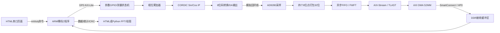
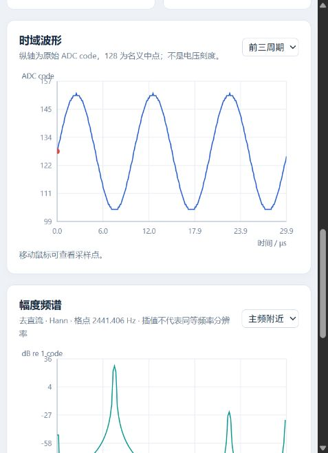

# Z100：CORDIC 发波、AD 采集与串口波形/频谱测量台

面向 **正点原子 Z100 / XC7Z035FFG900-2 / J37 配套 AD9280、DA 模块 / Vivado 与 SDK 2018.3** 的学习工程。

本版已为手写 Verilog、ARM C、Python、HTML/JavaScript 和 Tcl 脚本补充中文分段注释。厂商 IP、Vivado 自动生成的包装和网表保持由工具管理。

- 开发分支：[feature/cordic-loop-20261028](https://github.com/WuWingKit/z100-ad9280-capture/tree/feature/cordic-loop-20261028)
- 注释阅读版下载：[v0.2.1-20261028](https://github.com/WuWingKit/z100-ad9280-capture/releases/tag/v0.2.1-20261028)
- 深入阅读：[代码阅读指南](docs/CODE_GUIDE.md) · [实现原理](docs/IMPLEMENTATION.md) · [上板步骤](docs/BOARD_TEST.md)

**验证边界：本工程已通过数字仿真、离线构建和算法测试，尚未完成本版真实 DA→AD 模拟回环实测。真实输出电压、增益、极性和零相位延迟需要上板标定。**

## 1. 这个工程做什么



第一阶段是**一次命令、一次采集、一次回传**。CORDIC 用于产生正弦，FFT 用于测量采集信号的主频。FFT 在电脑上执行，PS 负责控制和搬运检查，PL 负责确定性的硬件时序。本版没有连续串口流、乒乓缓存、PL FFT 或雷达角度/距离处理。

## 2. 先看效果，不接开发板也能运行

1. 安装 Python 3。网页本身不需要安装 numpy、Node.js 或外部前端库。
2. 解压完整工程包，双击 `web/start_dashboard.cmd`。
3. 用**桌面 Chrome / Edge**打开 `http://127.0.0.1:8765`。
4. 点击“载入已验证的仿真数据”，观察时域、频谱与约 **99.992 kHz** 的结果。
5. 切换“前三周期 / 完整帧”和“主频附近 / 0–5 MHz”；可保存 CSV、JSON、图像。

手动启动方式：

```powershell
python web/serve.py --open
```

网页只从本机读取文件，没有外部 CDN、云端上传或自动串口连接。演示不会访问开发板。关闭命令窗口或 Ctrl+C 可停止服务；若服务已在运行，直接打开网址即可，不必重复启动。不要只双击 `index.html`，本地 HTTP 服务能避免文件协议下的资源/串口限制。



## 3. 下载哪一个包

| 下载内容 | 用途 |
|---|---|
| `z100_cordic_loop_20261028_review.zip` | 完整工程、生成IP、SDK工作区、源码与网页；初学者优先使用 |
| `z100_cordic.bit` + `adc_uart.elf` | 同一版本的PL配置与ARM应用，不能混用旧版文件 |
| `z100_cordic.hdf` | SDK创建硬件平台所需描述，包含本版bit |
| `z100_dashboard_20261028.zip` | 独立网页包，适合另一台电脑；不包含开发板固件 |
| `BOARD_TEST.md` / `TEST_REPORT.md` | 上板操作说明 / 验证记录 |
| `SHA256SUMS.txt` | 核对附件完整性 |

Git仓库保存手写源码、BD/XCI、文档与证据，生成缓存和二进制通过Release分发。`v0.2.0`是前一版本；`v0.2.1`补注释/排版/文档，并重新验证和构建。

## 4. 工程入口与文件结构

完整包解压后，在Vivado选择 **Open Project → `bd_start.xpr`**。顶层仍叫 `z100_adc_top`，沿用旧名称；BD叫 `capture_bd`。

```text
bd_start.xpr                         完整工程入口
rtl/
  z100_adc_top.v                      板级接口、时钟、ODDR、BD连接
  measurement_core.v                 发波/采样/组帧/控制状态机
  fifo_to_axis.v                     FIFO读出与AXIS握手
software/main.c                      ARM裸机驱动、命令、DMA、CRC
web/
  index.html                         页面结构与样式
  app.js                             串口、组帧、绘图、导出
  signal.js                          CRC、FFT、参考相位拟合
  serve.py / start_dashboard.cmd      本地网页服务
pc/capture_analyze.py                 Python采集/FFT/绘图替代方案
sim/
  tb_measurement.v                   核心/实际CORDIC和FIFO IP仿真
  tb_loop_ddr.v                      完整BD/DMA/DDR仿真
constraints/z100_adc.xdc              引脚、电平、输入/输出时序
scripts/                             构建、仿真、打包和Debug脚本
docs/                                原理、阅读指南、测试步骤
hardware/                            bit/ELF/HDF及物理实现报告
evidence/                            原始仿真CSV、图像、日志、校验记录
```

`rtl/adc_board_control.v`、`bd_start.srcs/sources_1/new/`的旧模块是历史参考，不是本版生效逻辑。Vivado的`ip/`、`ipshared/`、`sim/`、`synth/`等自动生成文件无需逐行学习，也不要在里面改业务逻辑。

## 5. 建议按这个顺序读代码

| 顺序 | 文件 | 先理解的内容 |
|---|---|---|
| 1 | [docs/CODE_GUIDE.md](docs/CODE_GUIDE.md) | 一帧数据怎么走完，几个“完成”标志为何不同 |
| 2 | [rtl/z100_adc_top.v](rtl/z100_adc_top.v) | AD/DA时钟、复位和BD如何接到板子 |
| 3 | [rtl/measurement_core.v](rtl/measurement_core.v) | 7个状态、相位清零、CORDIC延迟、四点打包 |
| 4 | [rtl/fifo_to_axis.v](rtl/fifo_to_axis.v) | FWFT、TVALID/TREADY、字计数、TLAST |
| 5 | [software/main.c](software/main.c) | 按编号从初始化读到一次measure，再读CRC/错误处理 |
| 6 | [web/signal.js](web/signal.js) | 先读parsePacket/analyze，再读FFT蝶形和相位拟合 |
| 7 | [web/app.js](web/app.js) | 用户点击→发命令→字节组行→完整帧→绘图 |
| 8 | [sim/](sim/)与[scripts/](scripts/) | 仿真怎样证明数据一致，构建产物怎样生成 |

Verilog描述并行电路：多个`always`同时工作，`<=`是时钟沿后的非阻塞更新。C是ARM顺序程序。JavaScript在电脑浏览器处理事件/绘图。这三部分运行在不同地方，并不是一个大程序按文件顺序执行。

## 6. 上板操作：先自检，再真实回环

详细步骤见[BOARD_TEST.md](docs/BOARD_TEST.md)。本版只准备 **JTAG Debug易失测试**，不写Flash。

1. 按配套示例确认J37方向、数字IO银行供电；DA**模拟输出**接AD**模拟输入**并共地。先确认实际输出电压在AD允许范围内。
2. 连接JTAG与PS USB串口；SDK打开包内`sdk_workspace`。
3. Program FPGA选择`hardware/z100_cordic.bit`；调试`adc_uart`时选择本版ELF。
4. 如果停在`main`，点击 **Resume**。程序运行后等待命令，不自动发波。
5. 关闭SDK Terminal/串口助手，释放串口；浏览器点击“连接串口”，选择Z100 PS USB串口，115200/8N1。
6. 点击“递增码自检”，应看到RAMP数据及完整性通过；RAMP不做单音测频。
7. 确认模拟接线和电压后勾选页面确认框，点击“采集真实AD数据”。
8. 保存CSV、分析JSON、PNG和串口原文，随后再开始下一帧。

**另一台电脑首次打开SDK时**，工程包不包含个人`.metadata`。如果Project Explorer为空：选择 **File → Import → General → Existing Projects into Workspace**，根目录选解压包中的`sdk_workspace`，导入`z100_hw`、`adc_bsp`、`adc_uart`三个项目；项目已在该目录时不要勾选复制到同一工作区。导入后执行Build All，再启动Debug。

如果Debug提示找不到源文件，是ELF中的原编译路径与本机路径不同：将Source Lookup指向本机`adc_uart/src`，或在导入后的SDK中重新Build。本版源码与ELF已同步，重新编译不会要求改业务代码。

只下载bit不会运行ARM程序。网页、SDK Terminal和其它串口助手不能同时占用同一串口。

## 7. 参数与串口命令

| 参数 | 范围/默认值 | 含义 |
|---|---|---|
| 采样/DA更新频率 | 固定10 MHz | 本版硬件时钟，不是串口波特率 |
| AXI时钟 | 100 MHz | PS/PL控制与DMA接口 |
| DA频率 | 1 kHz～1 MHz，默认100 kHz | PS换算成32位相位控制字K |
| N | 256/512/1024/2048/4096，默认4096 | **8位样本数/字节数**，不是32位字数 |
| delay | 0～255，默认3 | 整数采样周期补偿，1周期=100 ns |
| amplitude | 0～96 | 数字码值幅度，不是伏特；网页默认8，CLI无参数默认24 |

命令需要回车，网页会自动添加：

```text
t 100000 4096 3 8    # 板内递增码自检，DA保持中点
m 100000 4096 3 8    # 真AD采样，同时DA发正弦；c是m的别名
s                    # 查看状态
q                    # 停止/复位
r                    # 整条DMA/FIFO/控制路径复位
h                    # 帮助
```

上面的`#`是说明，手动发串口命令时不要输入注释。采集轮询期间单独字符`q`可中止；已经进入串口打印阶段，则在打印结束后处理。失败后须复位再重测。

`done`/`TLAST`/DMA完成不是同一事件。PS必须等DMA IOC且不忙，才读DDR并ACK；详见代码指南和寄存器表。

## 8. 结果如何解释

- 4096点/10 MHz的采集窗口为409.6 μs，FFT格点为2441.40625 Hz。
- 频谱去直流、加Hann窗并做峰值插值；插值小数位不代表能区分同样间隔的两个频率。
- 波形纵轴为ADC code，128是名义中点；未标定时不能换算成伏特或dBm。
- `delay=3`只在数字模型中对齐；实物首点不一定为128，模拟滤波/线缆/器件延迟需要标定。
- 窗口不足3个参考周期时网页会警告，变化小于2 code时不报告主频。
- CRC通过证明数字数据完整性，不证明模拟信号质量；RAMP通过也不代表ADC模拟链路已正常。
- ASCII回传4096点需约1秒以上，采集本身仅409.6 μs。本版不是10 MSPS连续串口输出。

## 9. 修改后怎样重新验证和构建

### 完整工程包

在工程目录执行，按本机安装位置调整路径：

```powershell
$env:PROCESSOR_ARCHITECTURE='AMD64'
# RTL改动后刷新BD引用；普通只读学习不需要执行
& E:/Xilinx/Vivado/2018.3/bin/vivado.bat -mode batch -source scripts/refresh.tcl
& E:/Xilinx/Vivado/2018.3/bin/vivado.bat -mode batch -source scripts/run_sim.tcl
& E:/Xilinx/Vivado/2018.3/bin/vivado.bat -mode batch -source scripts/run_ddr_sim.tcl
& E:/Xilinx/Vivado/2018.3/bin/vivado.bat -mode batch -source scripts/build_bitstream.tcl
# 修改software/main.c后复制到SDK应用并重新编译
& E:/Xilinx/SDK/2018.3/bin/xsct.bat scripts/rebuild_software.tcl
```

`build_software.tcl`仅用于**空SDK工作区首次创建**。已有工作区用`rebuild_software.tcl`或SDK Build Project，避免重复创建同名工程。修改时先改`software/main.c`，重建脚本会同步到SDK的src目录。

### 只有Git源码

```powershell
git clone --branch feature/cordic-loop-20261028 https://github.com/WuWingKit/z100-ad9280-capture.git
cd z100-ad9280-capture
& E:/Xilinx/Vivado/2018.3/bin/vivado.bat -mode batch -source scripts/recreate_project.tcl
```

打开新生成的`_rebuild_cordic/bd_start.xpr`，在该工程中用GUI综合/实现并导出硬件。上面的根目录批处理脚本主要用于完整工程包；不要把不同工程目录的生成结果混用。

历史`configure.tcl`是一次性从旧ADC工程迁移到新BD的脚本，不要在现成新BD上重复执行。`probe_cordic.tcl`仅是开发时查IP属性的辅助工具。

### 软件/网页算法测试

```powershell
python -m pip install -r pc/requirements.txt
python pc/test_analysis.py
node web/test_signal.cjs
```

Node.js只用于开发者运行网页算法测试，普通打开网页不需要安装它。Python串口/绘图替代入口见`pc/capture_analyze.py --help`；浏览器与Python采集程序不能同时打开同一串口。

## 10. 常见问题

| 现象 | 排查位置 |
|---|---|
| 网页没有串口API | 桌面Chrome/Edge，使用127.0.0.1 HTTP网址 |
| 连接失败/串口被占用 | 关闭SDK Terminal、串口助手、另一网页或Python采集进程 |
| 只有蓝牙COM口 | 检查PS USB串口接线、驱动和板卡上电；不是选任意COM口就能用 |
| 12秒没有完整帧 | PS是否Resume、是否使用本版ELF、115200/8N1、命令是否换行 |
| RAMP通过但AD近似常数 | 数字链路可通；检查真实模拟输入/DA输出/模块增益和接线 |
| CRC或长度失败 | 保存原文；检查混入旧固件/其它串口输出，不能忽略错误后继续FFT |
| 首点不是零相位 | delay=3不是实物标定值；根据波形与参考相位拟合调延迟 |
| Vivado提示out-of-date | 源码时间或内容变化导致，按刷新/仿真/构建流程重新生成 |

## 11. 验证证据和协作

[TEST_REPORT.md](docs/TEST_REPORT.md)记录实际仿真和构建结果；[verification.json](evidence/verification.json)记录产物哈希与未实测项目；[CDC_REVIEW.md](docs/CDC_REVIEW.md)说明复位/FIFO诊断和稳定参数协议。

注释版另外保存`evidence/comment_readability_check.json`：比较C/Verilog有效token、Python AST和JavaScript AST，检查注释/排版没有改变执行逻辑。之后仍重新编译、仿真并运行算法测试。

组员修改建议从功能分支开发并提交PR，说明改了哪段数据路径、如何验证；不要直接编辑厂商生成文件，不要把一次仿真PASS写成真实硬件验收通过。
