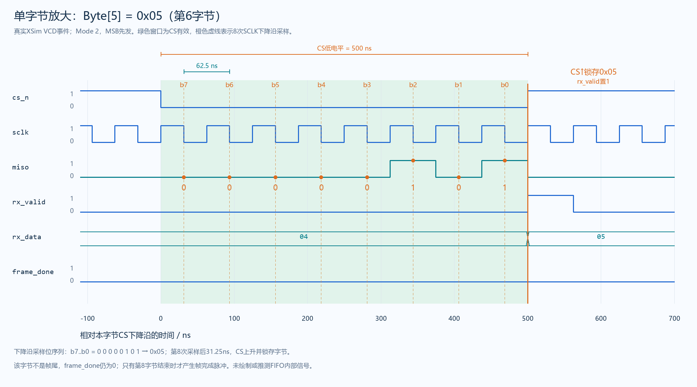

# Z100 SPI-to-DDR Capture — 8-byte Debug Build

   

[English](README.md) | [简体中文](README.zh-CN.md) | [日本語](README.ja.md) | [한국어](README.ko.md) | [Русский](README.ru.md) | [Português](README.pt.md) | [Español](README.es.md) | [Français](README.fr.md)

This branch is the SPI-only preliminary data-path experiment for SWU signal-processing group 3. The existing `main` branch retains the earlier ADC/CORDIC baseline. It is not a complete phased-array radar implementation.

**PS ARM prepares bytes → PS hardware SPI0 slave → internal EMIO → PL SPI master → 32-bit packing → asynchronous FWFT FIFO → AXI-Stream → AXI DMA S2MM → PS HP0 → DDR → PS compare/CRC32 → UART.**

## Download and reports

- [SPI debug release and complete Vivado/SDK project](https://github.com/WuWingKit/z100-ad9280-capture/releases/tag/v0.4.0-spi-20261105) — download `z100_spi_complete_project_20261105.zip` for generated products, SDK workspace, bit/HDF/ELF and evidence.
- [Editable Feishu progress report, dated 2026-11-05](https://scnk2ajxowqf.feishu.cn/docx/XQePdnk7Hon2r9xViTucwbkNnDb) — created with the user's identity; experiments were performed on 2026-11-04.
- [Offline illustrated progress report](docs/report_20261105/report.html).
- [Board-debug instructions](docs/SPI_BOARD_DEBUG.md).

## Protocol

| Parameter | Current implementation |
|---|---|
| Master / slave | PL master / PS SPI0 hardware slave, internally connected through EMIO |
| Mode / order | Mode 2 (CPOL=1, CPHA=0), 8-bit, MSB first; falling-edge sampling |
| SCLK | 16 MHz from a Clocking Wizard/MMCM; input board clock is differential 100 MHz |
| CS | 1 MHz cadence during a burst, 500 ns low and 500 ns high; 8 falling edges per byte |
| Capture length | Exactly 8 bytes per START; CS stays high afterward |
| DDR length | 8 bytes / two 32-bit words; TLAST on the second word |
| UART | PS UART0, 115200 / 8N1, no flow control; terminate each command with a real CR (`0D`) |

No external SPI source or signal jumpers are required. This build removes parallel ADC/DA pins and the CORDIC IP. Sine test bytes are generated by PS lookup-table code. FFT reporting is intentionally disabled for 8-byte debug frames.

## Dependencies and build

| Tool | Version / use |
|---|---|
| AMD/Xilinx Vivado | **2018.3**, target `xc7z035ffg900-2`; licensed device support required |
| Xilinx SDK / standalone BSP | **2018.3**, Cortex-A9 bare-metal C application |
| Python | Tested **3.12.14**; dependency-free evidence checks and local web server |
| Node.js | Tested **22.19.0**; browser parser/flow checks |
| Pillow | Tested **12.3.0**, install `Pillow>=10.0` to redraw detailed VCD timing figures |
| Matplotlib | Optional `>=3.8`, only needed for the older overview plotting script |
| Browser | Desktop Chrome/Edge with Web Serial support for the optional dashboard |

Repository handwritten sources are UTF-8. The complete Windows Vivado project ZIP uses GBK for handwritten legacy IDE files. If your Vivado editor requires GBK, run `python scripts/source_encoding.py --target gbk`; it leaves web/Python/Markdown unchanged.

Open `spi_capture.xpr`, regenerate BD/IP output products when needed, then use:

```powershell
$env:PROCESSOR_ARCHITECTURE='AMD64'
& E:/Xilinx/Vivado/2018.3/bin/vivado.bat -mode batch -source scripts/test_spi_burst8.tcl
& E:/Xilinx/Vivado/2018.3/bin/vivado.bat -mode batch -source scripts/run_sim.tcl
& E:/Xilinx/Vivado/2018.3/bin/vivado.bat -mode batch -source scripts/run_ddr_sim.tcl
& E:/Xilinx/Vivado/2018.3/bin/vivado.bat -mode batch -source scripts/build_spi_bitstream.tcl
```

`scripts/build_spi_workspace.tcl` creates a **new** `sdk_spi_workspace` containing `z100_hw`, `spi_bsp` and `spi_uart`; do not run project-creation commands over an already populated SDK workspace. The complete release ZIP includes the built workspace. Different machines may need to regenerate IP products or repair local SDK paths.

## Board debug and commands

Use JTAG and the **PS USB UART**. Program `hardware/z100_spi_sim.bit`, then Debug `spi_uart` on `ps7_cortexa9_0`, initialize PS with the matching `ps7_init.tcl`, stop at `main`, connect the terminal and press Resume/F8. This is a volatile JTAG workflow; Flash programming is not part of this release.

```text
t 100000 8 3 8    # ramp: 00 01 02 03 04 05 06 07
m 100000 8 3 8    # PS-generated sine bytes
s                 # status
q                 # stop/reset
```

Send each line with a real CR, not the two literal characters `\n`. The `delay`, `phase_word`, `otr` fields and the help word `real` are inherited compatibility fields, not evidence of an active ADC path. `fs=1000000` is the byte-sample cadence, not SCLK.

## Evidence and limits

- Exported board log: **8 successful frames**, 3 ramp + 5 sine, 64 payload bytes; all length, sum/min/max and CRC32 checks independently recomputed. Stop/reset, illegal-length rejection/recovery, 200 kHz and amplitude-16 parameter tests passed.
- SPI simulation: 32 bursts cover all 256 byte values; 8-byte limit and 64-bit latch verified. Core/FIFO/AXIS: 5 frames, 145 checks. BD/DMA/DDR: 2 frames, 966 checks, 752 protected bytes unchanged.
- Implementation timing: WNS **+5.783 ns**, WHS **+0.055 ns**. DRC: one advisory. **Three CDC Critical diagnostics remain for reset/FIFO paths**; timing success is not full CDC sign-off.
- Detailed timing figures come from actual **XSim VCD**, not hardware ILA. The logs establish functionality, not measured physical edge timing or sustained throughput.
- The short repeated-run sequence is not a 10-runs-per-mode or long-duration reliability test. External radar data, long frames, continuous DDR buffering and FFT performance remain future work.



See [raw board log](evidence/board_test_20261104/records-2026-11-04-16-36-31.json) and [independent analysis](evidence/board_test_20261104/serial_log_analysis.json). Do not mix bit/ELF files from the older ADC release with this SPI branch.
