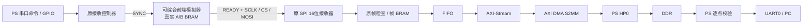

# Z100 FPGA 内部模拟前端 · SPI / 乒乓 / DDR Debug

日期：2026-11-12。工具：Vivado / Xilinx SDK 2018.3；器件：XC7Z035FFG900-2。

这是独立的板内调试工程，用于**没有雷达前端时验证接收、组帧和存储链路**。原外部前端工程 `../radar_spi_sync_20261111` 保持不变。本工程不引出 SPI、SYNC、READY 至扩展口，不需要 MCU、AD/DA 模块或飞线。



## 打开与下载

所有文件在本目录：

- Vivado：`radar_debug.xpr`。
- 硬件：`hardware/radar_debug.bit`；ILA：`hardware/radar_debug.ltx`。
- 硬件平台：`hardware/radar_debug.hdf`。
- PS 程序：`hardware/radar_debug_uart.elf`；源代码：`software/main.c`。
- SDK 工作区：`E:/FPGAWork/radar_spi_debug_sdk_20261112`，应用 `radar_debug_uart`。
- 详细步骤：[Debug 上板操作](docs/DEBUG_GUIDE.md)。

使用 JTAG 下载，PS 初始化后运行 ELF；打开 **PS USB 串口，115200 / 8N1**。发送 `t` 后按真实回车（HEX：`74 0D`），执行共享复位、首帧预热和三帧完整校验。不会自动开始采集，不写 Flash。

本次已在Z100上取得以下成功提示，且额外完成连续22帧、故障恢复和ILA实测；完整证据见 [板测报告](docs/BOARD_TEST_REPORT.md)：

```text
FPGA PATTERN seq=0 complex_samples=11776 errors=0 PASS
FPGA PATTERN seq=1 complex_samples=11776 errors=0 PASS
FPGA PATTERN seq=2 complex_samples=11776 errors=0 PASS
FPGA LOOP SELFTEST PASS frames=3 bytes=141408 previous_frame_sequence_and_beam=PASS
```

## 模拟内容与边界

1. PS 请求使接收器发出 SYNC。模拟器响应其上升沿，并拉低 READY。
2. 第一次 SYNC 只填 A，写好与其数据同属一帧的头部，恢复 READY，不发送 SPI。
3. 第二次 SYNC 填 B，然后将上一轮 A 通过串行 SPI 发出；下一次填 A、发 B。帧序号与波束编号随缓存锁存，不能按当前 SYNC 推算上一帧的波束。
4. 为使行为易于观察，模拟器按“先填新缓存、再发送旧缓存”顺序执行。它验证 A/B 所有权和上一帧关联；不模拟真实 ADC DMA 的并行采集时序。
5. 源时钟为 PS FCLK0 100 MHz；SPI Mode 0、16位字、MSB 先发，SCLK 12.5 MHz。CS 在一整帧期间保持低，字间允许停钟。首个字是帧头 `A610`。这是当前雷达帧协议，不是早期8字节练习的时序。
6. 每次模拟采集24个 chirp、每 chirp 512点；丢弃首 chirp，输出32字节头部和23×512×4字节IQ，共47,136字节。每32位内先传低16位，再传高16位；PS DDR中为小端。
7. 每个IQ样点为 `I=原采集样点索引`，`Q=0x8000 | 帧序号`。有效载荷索引从512到12287。它们是校验码，不是测得的雷达IQ，也不是正弦信号。
8. 波束从9（0°）开始，10（5°）、11（10°）……18后回0；帧序号从0开始。版本3头部保留上一轮的序号、波束及角度。
9. 原接收器先缓存完整帧并检查头部、长度、序号，再输出FIFO；DMA写DDR后由PS确认。此版本不增加FFT、目标检测或真实射频测量。

## 命令

所有命令均需回车，勿把字符串 `\r` 当回车发送。

|命令|HEX（含回车）|作用|
|---|---|---|
|`t`|`74 0D`|完整正向自检：重置、预热、三帧DMA入DDR并逐点核对|
|`s`|`73 0D`|状态，空闲READY应为1|
|`r`|`72 0D`|同时重置接收器、DMA与内部模拟源；随后需`p`|
|`p`|`70 0D`|预热，第一次只采不发|
|`c`|`63 0D`|采下一帧，同时接收上一帧入DDR|
|`v`|`76 0D`|核对最近有效帧的全部11776个IQ样点|
|`d`|`64 0D`|串口导出整帧，数据较多|
|`b`|`62 0D`|注入错误头部XOR，预期被拒绝|
|`l`|`6C 0D`|截短4字节，预期被拒绝|
|`n`|`6E 0D`|模拟无SPI响应，预期超时|

故障测试前执行 `r`、`p`，故障后也需 `r`、`p` 才能继续。故障场景出现 `CAPTURE FAILED` 属于预期，不能写为正常采集成功。

## 代码阅读与复现

先读 `rtl/radar_frontend_sim.v`：状态机、A/B BRAM、头部封装、SPI移位；再读 `rtl/radar_frame_capture.v`、`rtl/radar_fifo_to_axis.v`；最后读 `software/main.c` 的 `run_debug_selftest()`。

仿真脚本：`scripts/run_source_tests.tcl` 和 `scripts/run_ddr.tcl`。分别用 Vivado Tcl Console `source` 对应脚本，或批处理运行。它们各自启动仿真；DDR测试通过testbench参数缩短帧长，不修改生产BD参数。结果位于 `evidence/`。具体覆盖及未验证事项见 [验证记录](docs/VALIDATION.md)。

硬件重建：`scripts/build_hardware.tcl`。SDK首次创建：`scripts/build_software.tcl`；已有工作区更新使用 `scripts/rebuild_software.tcl`。`create_debug.tcl`仅用于尚未创建BD的初次构建；不要在已有工程中重复创建同名组件。所有源码使用UTF-8，HDL/C注释采用ASCII以兼容旧版工具。
