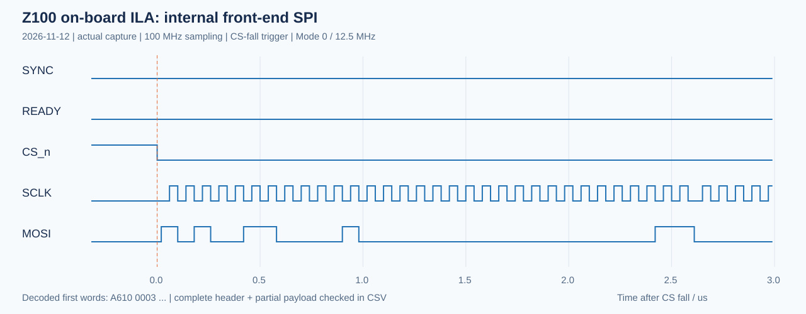

# Z100 无前端 SPI/DDR 调试实测记录

**日期：2026-11-12；板上测试时段：17:02—17:06。结论：通过。**

本次没有连接雷达前端。FPGA中的可综合模拟器建立真实A/B BRAM、封装头部并产生SPI串行信号；原SPI接收器、完整帧检查器、FIFO、AXI-Stream、DMA、HP0和DDR均参与实际板上运行。PS经UART0输出结果，电脑做独立复核。测试数据全部为合成校验码，不能作为真实雷达性能测试。

## 环境与下载

|项目|本次配置|
|---|---|
|开发板|正点原子Z100，XC7Z035FFG900-2|
|工具|Vivado / SDK 2018.3；XSCT经JTAG下载|
|PS串口|COM11，USB-SERIAL CH340，VID 1A86 / PID 7523|
|串口参数|115200、8N1、无流控|
|FPGA系统时钟|PS FCLK0，100MHz|
|SPI|板内，Mode 0，16bit/MSB先发，12.5MHz；一整帧CS保持低|
|程序|`hardware/radar_debug.bit` + `hardware/radar_debug_uart.elf`|
|调试探针|同一构建的 `hardware/radar_debug.ltx`，ILA深度4096|
|Flash|未写入；只进行易失JTAG配置|

`scripts/debug_jtag.tcl`完成系统复位、bit下载、匹配的PS初始化、ELF下载及运行。`scripts/test_board.py --port COM11 --program`负责串口测试和原文留存。Python依赖pyserial 3.5。

## 正向测试

先发送 `t`，自动复位双方并预热，验证三帧；随后继续19次 `c,v`，累计连续22帧，未在帧间重置。每帧47,136字节，累计 **1,036,992字节**；每帧逐点检查11,776个复数样点，累计 **259,072个IQ样点**。

所有帧头检查、长度、DDR尾部保护区及样点比较均无错误。帧序号连续0—21；波束从9开始，经历18→0，并回到9后继续。示例对应关系如下：

|收到的帧序号|波束索引|角度|结果|
|---|---|---|---|
|0|9|0°|通过|
|1|10|5°|通过|
|2|11|10°|通过|
|9|18|45°|通过|
|10|0|-45°|通过|
|19|9|0°|通过|
|21|11|10°|通过|

第一次SYNC仅建立A，不传帧；第二次SYNC建立B、传A。上述序号和波束来自**上一轮缓存的头部**，与其IQ载荷对应，不是直接采用当前SYNC所指定的新波束。

程序实际输出包括：

```text
FPGA LOOP SELFTEST PASS frames=3 bytes=141408 previous_frame_sequence_and_beam=PASS
```

随后电脑用 `d` 导出序号21的完整帧，保存为 `frame_seq0021.bin`。电脑独立拆解小端头部、计算头部XOR、逐样点构造期望值并比较：

- 帧长47,136字节，序号21、波束11。
- 载荷I为512—12287，Q为0x8015。
- 全部11,776个IQ样点比较错误数0。
- 本地载荷CRC32为 **A7916953**，与PS结果相同。当前线协议不含载荷CRC；此处CRC是导出一致性证据，逐样点比较提供已知测试模式的内容校验。

## 异常拒绝与恢复

每项独立执行 `r,p,故障命令`，然后读取状态；再执行 `r,p,c,v`检查恢复。以下均为板上实测：

|命令|注入内容|最终错误码|状态|恢复结果|
|---|---|---|---|---|
|`b`|帧头XOR翻转1bit|0x02|FAULT=7，拒绝有效帧|序号0整帧校验通过|
|`l`|帧尾少4字节|0x10|FAULT=7，拒绝有效帧|序号0整帧校验通过|
|`n`|READY响应但不发送SPI帧|0x40|超时，FAULT=7|序号0整帧校验通过|

正常路径不会将故障帧确认为有效DDR帧。故障锁定后需复位；`r`同时重置内部源、接收器与DMA，避免重置一端后序号错位。三次恢复各额外验证一整帧，不计入上面的连续22帧。

## ILA真实时序

之后额外触发一帧（序号1、波束10），PS逐点校验通过，同时ILA以CS下降沿触发。实际采集4096点，采样100MHz，覆盖40.96µs；第512点为CS下降沿。原始CSV中解码出27个完整SPI16位字，全部符合头部和部分载荷期望值。

```text
A610 0003 0010 000A 01F4 0013 0200 0017
0018 0004 A286 0001 B820 0020 0001 BF63
0200 8001 0201 8001 0202 8001 0203 8001 ...
```

相邻SCLK上升沿多数间隔8个100MHz采样周期，即12.5MHz；32位字边界间隔11周期，是状态机读BRAM产生的合法停钟间隔。不是连续无间隙SPI。此窗口覆盖完整头部及部分载荷，**没有覆盖整帧**；整帧正确性另由DDR逐点校验验证。



原始数据：`evidence/board_spi_ila.csv`、`evidence/board_spi_ila.ila`；解码结果：`evidence/board_ila_result.json`。图由真实CSV绘制，SYNC在此窗口为低：SYNC发生在填充新缓存之前，比CS下降沿更早，不在当前触发窗口内。

## 硬件实现检查

- 布线后WNS **+4.041ns**，WHS **+0.044ns**；建立、保持违例端点均0。
- LUT 4,581（2.66%），寄存器7,037（2.05%），BRAM 62（12.40%），DSP 0。
- DRC无Error；保留1项RTSTAT-10 Warning（调试核内部无可布线负载）及1项REQP-181 Advisory（DMA内部FIFO的WRITE_FIRST模式）。未降低检查等级或忽略错误生成bit。
- CDC报告调试JTAG与系统时钟间186个端点均标为Safe，无Unsafe/Unknown；外部复位路径标为Safe。

## 留存位置与复现

有效板测批次：`evidence/board_20261112_170218/`，其中：

- `results.json`：各项测试结果、时间、bit/ELF/LTX的SHA256。
- `uart_log.txt`：带发送时间和HEX命令的完整原文。
- `uart_rx.bin`：接收字节原样留存。
- `frame_seq0021.bin`：独立复核的完整帧。
- `jtag_program.txt`：实际下载日志。

`evidence/board_test_runner.txt`以 `BOARD_TEST_PASS`结束。更早尝试的目录也保留：一次是SDK批处理启动器不能处理带空格的脚本参数，一次是记录脚本选中了残留旧状态行；修正主机脚本后重跑得到上述完整通过批次。它们不能替代最终批次，也不作为FPGA故障计数。

本次仅验证板内合成源。尚未验证外部MCU电平/布线、真实ADC/RF数据、前端ADC DMA与SPI DMA并行带宽，以及实际波束方向和雷达探测算法。
